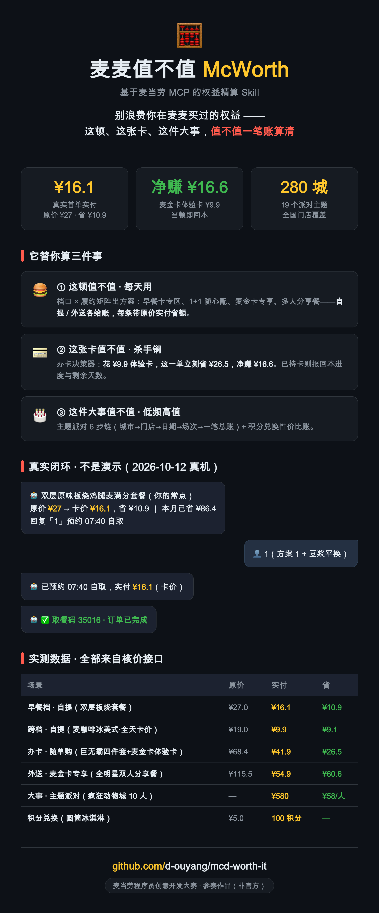
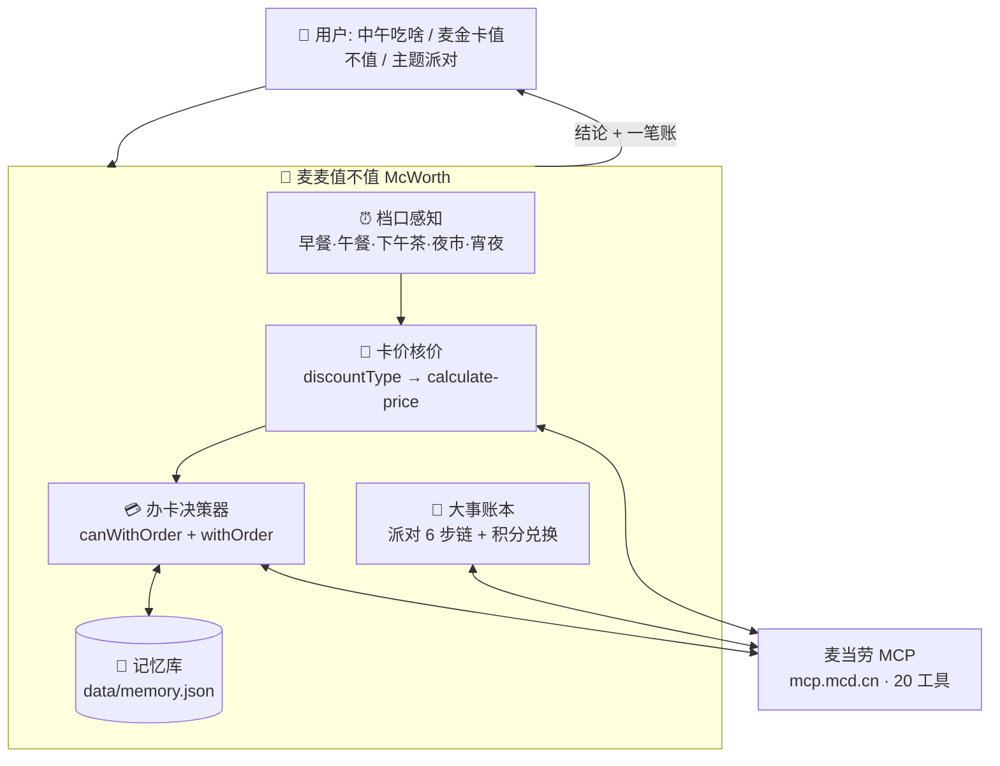

# 🧮 麦麦值不值 McWorth

**基于当前时间和你的账户权益，把最划算的点单方案直接端到你面前**——原本要在 App 里翻菜单、比价格、挑券、选自提还是外送的十几步，压缩成一次确认。


> **🧮 一句话**：用麦当劳 MCP 把点单算成一笔账——**这顿值不值、这张卡值不值、这件大事值不值**，一次确认搞定。所有数字来自核价接口实时返回，不是估算。
>
> **真实首单闭环（真机跑通，非演示）**：说一句"推荐一份早餐" → 早餐档核价 **¥27 → ¥16.1**（省 ¥10.9）→ 预约 07:40 自取 → 支付 → **取餐码 35016 · 订单已完成**。全程 36 分钟，人只做"选方案 + 付钱"两个动作。

<p align="center"></p>

## 为什么是它

在 App 上吃顿"划算的麦当劳"，实际要走十几步：打开 App → 翻菜单找哪个有优惠 → 对比套餐价 → 挑券 → 算是自取便宜还是外送划算 → 下单。而且每个档口菜单都换一遍，早上算好的账中午作废。买了早餐卡的人还得自己记着"这个月回本了没"，犹豫麦金卡的人只能看到"开通享 XX 项权益"的口号，看不到**你常点的那个套餐，持卡到底省多少**。

麦麦值不值把这条流程压缩成一次确认：**时间和账户信息它都知道**——档口几点开几时关、你有什么卡、卡价商品是哪些、常点是什么、外送划不划算，全部由 MCP 接口实时算好，方案带账端到你面前，你只剩选。所有数字不是估算：

| 场景 | 实测样例 | 原价 | 实付 | 省 |
|---|---|---|---|---|
| 早餐档 · 自提 | 吉士蛋麦满分组合（早餐卡 6 折） | ¥12.0 | **¥7.2** | ¥4.8 |
| 跨档 · 自提 | 麦咖啡™冰美式（早餐卡价全天生效） | ¥19.0 | **¥9.9** | ¥9.1 |
| 下午茶 · 自提 | 马苏里拉拉丝芝士条（促销） | ¥15.0 | **¥11.0** | ¥4.0 |
| 办卡 · 随单购 | 巨无霸四件套 + 麦金卡体验卡（15天） | ¥68.4 | **¥41.9** | **¥26.5** |
| 外送 · 麦金卡专享 | 全明星双人分享餐 8 件套（免配价） | ¥115.5 | **¥54.9** | ¥60.6 |
| 外送 · 多人分享餐 | 加牛欢享四人餐（含配送 ¥6 + 打包 ¥2.8） | ¥124.8* | **¥124.8** | ¥80.2* |
| 大事 · 主题派对 | 疯狂动物城主题（10 人档） | — | **¥580** | ¥58/人 |
| 积分兑换 | 圆筒冰淇淋（100 积分兑 ¥3.9 商品） | ¥5.0 | **100 积分** | — |

\* 多人分享餐为外送菜单促销价（划线价口径），外送还需支付配送费——"值不值"永远合并履约成本计算。样例价格随门店/时段浮动，Skill 输出一律以实时核价为准。

关键一行：花 ¥9.9 随单购一张麦金卡体验卡，**这一单立刻省回 ¥26.5，净赚 ¥16.6**。这不是营销话术，是核价接口盖章的数字。

## 三层能力

**① 这顿值不值 —— 推荐计划，每天用**
> "中午吃啥" → 档口感知（还剩几分钟）→ 按**档口 × 履约方式矩阵**出推荐计划：早餐档推早餐卡专区（6 折组合 + 咖啡 ¥9.9）、正餐推 1+1 随心配 / 麦金卡专享、周末推麦麦周末与多人分享餐——自提、外送各给方案，每条带账。
> 履约双方案并行：**到店自取 / 预约自取**（睡前订好，明早路上拿）vs **麦乐送**（独立核价，配送成本算进"值不值"；配送时长过长直接否决外送）。
> 配合定时任务：工作日早上一张"早餐决策卡"，回复一个数字才下单。

**② 这张卡值不值 —— 双卡经营，杀手锏**
> **早餐卡**（已办）：每顿报账"原价 ¥27 → 卡价 ¥16.2"，回本进度条 + 剩余天数预警，"还差 ¥x 回本、还能吃 n 个早餐档"。
> **麦金卡**（未办）：办卡决策器——"花 ¥9.9 体验卡，这一单立刻省 ¥26.5，净赚 ¥16.6"。开卡后自动转入"用满经营"，卡一旦充值，"不用就不划算"会让偶然顾客变成长期客户。

**③ 这件大事值不值 —— 低频高值**
> "主题派对 / 体验营" → 19 个在售主题（¥45–198/人，覆盖约 280 城），城市→门店→日期→场次→一笔总账，确认后下单。
> "积分能换啥" → 积分余额 + 可兑换清单 + 性价比账。

**底座：实付账本 + 本地记忆**——每一单的省额写入本地记忆库，喂给推荐计划与办卡决策器，越用越懂你；另有定时任务协议（早餐决策卡 / 卡到期提醒 / 晚间预约建议），详见 [SKILL.md](SKILL.md)。

## 使用示例（真实对话流）

**场景 A · 工作日早上 8 点，定时任务推送（每天自动发生）**
```
🤖 ⏰ 早餐档 10:15 截止，还有约 2h15m（1人 · 预算 ¥20）
   🏆 🧮 就这单：双层原味板烧鸡腿麦满分套餐（你的常点）
      里面有：双层原味板烧鸡腿麦满分 + 脆薯饼 + 鲜萃冰咖
      原价 ¥27 → 卡价 ¥16.2，省 ¥10.8 ｜ 本月已省 ¥86.4
   备选：吉士蛋麦满分组合 ¥7.2（卡价 6 折）
   回复"1"预约 08:50 自取 ｜ "2"配送到公司 ｜ "换一个"看备选
👤 1
🤖 已按 08:50 预约自取确认：实付 ¥16.2（卡价）。
   取餐时不用排队，出门直接拿走。
```
> 价值：你没打开 App，没翻菜单，没对比价格——一条消息，省 ¥10.8，上班路上顺手拿。

**场景 B · "麦金卡值不值？"（办卡决策）**
```
🤖 🧮 这张卡：麦金卡体验卡（15 天），¥9.9
   单笔实测：巨无霸四件套 原价 ¥58.5 → 持卡 ¥32.0，省 ¥26.5
   这一单净省：¥16.6
   判定：值。你过去 30 天点了 4 次四件套，全程持卡约省 ¥100+。
👤 那开一张
🤖 已确认随单购：麦金卡体验卡 + 巨无霸四件套，合计实付 ¥41.9（原价 ¥68.4）。
   卡已记入你的权益档案，15 天内每顿我都会帮你算回本进度。
```
> 价值：办卡从拍脑袋变成一笔账。¥9.9 当顿回本——这是核价接口盖章的数字，不是营销话术。

**场景 C · "中午吃啥，30 以内"（随手一问）**
```
🤖 🧮 就这单：马苏里拉拉丝芝士条 + 麦咖啡冰美式
   原价 ¥34 → 实付 ¥20.9，省 ¥13.1（促销+早餐卡价，咖啡卡价全天有效）
   为什么是它：下午茶档折扣最深的两件，合计卡在 ¥30 内
   ⏰ 下午茶档 16:45 结束，还剩 1h42m
   到店自取 ¥20.9 ｜ 麦乐送另核（外送菜单价更高 + 配送费）——顺路自取更划算
```
> 价值：给的是结论和账，不是 20 个商品的列表。连"外卖费会不会吃掉折扣"都替你算好了。

**更多入口**：睡前说一句"订明早的早餐"（预约自取）、"订个主题派对"、"积分能换啥"——同一套核价与确认流程，见 [SKILL.md](SKILL.md)。

## 架构



**一次对话，三个时间维度**：档口管"现在"，账本管"过去"，决策器管"未来"。完整工具编排见 [MCP_INTEGRATION.md](MCP_INTEGRATION.md)。

## 快速开始（本地部署，以 WorkBuddy 为例）

**前置条件**
- 麦当劳中国大陆会员，并在 [open.mcd.cn/mcp](https://open.mcd.cn/mcp) 申请到 **MCP Token**（本 Skill 的全部数据都来自这个官方接口）
- 安装 [WorkBuddy](https://www.workbuddy.cn)（也兼容 Cherry Studio / Cursor 等任意支持 MCP 的客户端）

### 1. 克隆仓库
```bash
git clone https://github.com/d-ouyang/mcd-worth-it.git
cd mcd-worth-it
```

### 2. 配置 MCP Token（环境变量，勿硬编码）
```bash
export MCD_MCP_TOKEN="你的token"
```
> macOS 可写入 `~/.zshrc` 永久生效；Windows 在「系统环境变量」里添加。WorkBuddy 启动时会读取该变量，**Token 永远不进仓库**。

### 3. 用 WorkBuddy 加载这个 Skill
打开 WorkBuddy，把**克隆下来的 `mcd-worth-it` 文件夹作为工作目录**——WorkBuddy 会自动识别目录里的 `SKILL.md`。
> 若未自动加载，进入 WorkBuddy 的技能设置手动指向该 `SKILL.md` 即可。Skill 的全部相对路径（`data/memory.json`、`data/ledger.json` 等）都以这个目录为根，账本与偏好只存本地、不上传。

### 4. 连接 mcd-mcp
在 WorkBuddy 的 MCP 设置里添加 mcd-mcp（类型 `streamablehttp`，地址 `https://mcp.mcd.cn`，请求头 `Authorization: Bearer ${MCD_MCP_TOKEN}`），或直接编辑 `~/.workbuddy/mcp.json`：
```json
{
  "mcpServers": {
    "mcd-mcp": {
      "type": "streamablehttp",
      "url": "https://mcp.mcd.cn",
      "headers": { "Authorization": "Bearer ${MCD_MCP_TOKEN}" }
    }
  }
}
```
保存后回到对话，WorkBuddy 提示 mcd-mcp 已连接。

### 5. 初始化本地记忆（可选但推荐）
```bash
cp data/profile.example.json data/profile.json
```
编辑填入通勤时间、配送地址——用于"预约自取"和"外送值不值"判断。

### 6. 开聊——任选一句触发
- **"中午吃啥"** → 档口感知 + 带账推荐（高频主线）
- **"麦金卡值不值"** → 办卡决策器（杀手锏）
- **"积分能换啥"** → 积分兑换性价比账
- **"订个主题派对"** → 低频高值 6 步链

下单、随单购、领券等写操作前 Skill 会逐项列出金额并等你确认，绝不静默消费。完整工具编排与安全红线见 [MCP_INTEGRATION.md](MCP_INTEGRATION.md) 与 [SKILL.md](SKILL.md)。

> 其他客户端（Cherry Studio / Cursor 等）配置 MCP 的方式相同：填同样的 `mcd-mcp` 地址与 Token，再把 `SKILL.md` 放入其 skill 目录即可。

## 目标用户

- 买了早餐卡 / 麦金卡但总用不满的人（沉没成本焦虑患者）
- 每次点单都在纠结"用哪张券最划算"的人
- 想订麦当劳主题派对 / 体验营、但根本不知道能订的家长

## 隐私与安全

- 记忆库与账本只存本地（`data/memory.json` 等），不上传、不外发；API 只回最近订单，你的历史偏好靠本地积累，越用越懂你
- 下单、领券、随单购等写操作前必须逐项确认，绝不静默执行
- 不读取、不推断、不存储你的会员卡官方状态——一切结论按"当前账号实付价"计算
- Token 走环境变量，仓库内只有占位符示例

## 技术栈

- 麦当劳官方 MCP Server（`https://mcp.mcd.cn`），20 个工具编排，详见 [MCP_INTEGRATION.md](MCP_INTEGRATION.md)
- WorkBuddy（开发与运行环境）

## 参赛信息

- 赛事：麦当劳程序员创意开发大赛
- 赛期：2026-10-09 ~ 2026-10-25
- 本项目为参赛者独立开发的参赛作品，非麦当劳官方产品

## License

[MIT](LICENSE)
