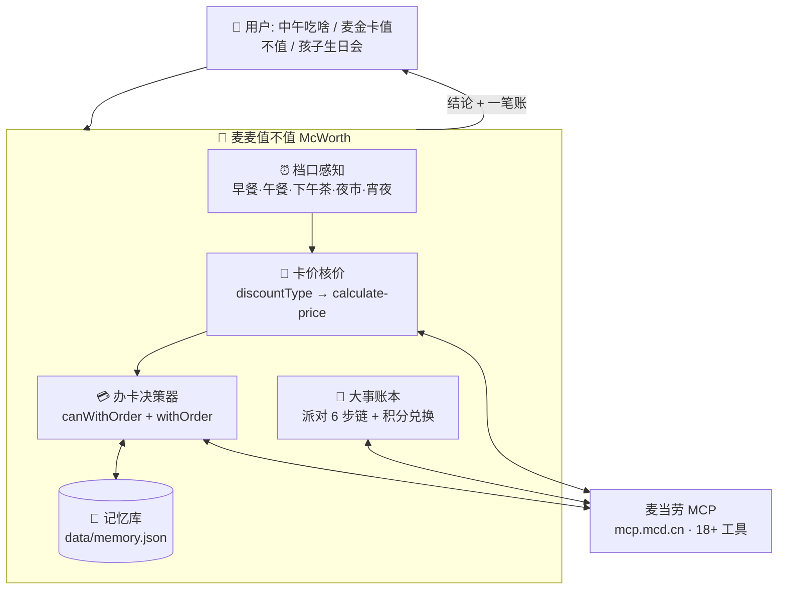

# 🧮 麦麦值不值 McWorth

**只算值不值的麦当劳权益精算 Skill**——不推荐你吃什么，只告诉你：这顿值不值，这张卡值不值，这件大事值不值。


## 为什么是它

你买了早餐卡，App 只会在菜单上标"早餐卡专享价"，但永远不会告诉你：**今天这顿省了多少、这个月回本了没有、档口还有几分钟截止**。你犹豫要不要开麦金卡，App 只会说"开通享 XX 项权益"，但不会告诉你：**你常点的那个套餐，持卡能省多少、一张 ¥9.9 的体验卡这一单就能赚回来**。

麦麦值不值补的就是这块空白。所有数字不是估算，全部来自麦当劳 MCP 接口的实时核价：

| 实测（2026-10-11，上海） | 原价 | 实付 | 省 |
|---|---|---|---|
| 吉士蛋麦满分组合（早餐卡价） | ¥12.0 | **¥7.2** | ¥4.8 |
| 麦咖啡™冰美式（卡价跨档仍生效） | ¥19.0 | **¥9.9** | ¥9.1 |
| 巨无霸四件套 + 麦金卡体验卡（15天） | ¥68.4 | **¥41.9** | **¥26.5** |
| 全明星双人分享餐 8 件套（**外送菜单**·麦金卡随单购价） | ¥115.5 | **¥54.9** | ¥60.6 |

最后一行是关键：花 ¥9.9 随单购一张麦金卡体验卡，**这一单立刻省回 ¥26.5，净赚 ¥16.6**。这不是营销话术，是核价接口盖章的数字。

## 三层能力

**① 这顿值不值 —— 每天用，接进通勤链路**
> "中午吃啥" → 档口感知（还剩几分钟）→ 只挑有优惠的商品 → 接口核价 → 一个结论带一笔账。
> 履约双方案并行给账：**到店自取 / 预约自取**（睡前订好，明早路上拿，零等待）vs **麦乐送到公司**（外送菜单独立核价，配送成本算进"值不值"）。
> 配合定时任务：工作日早上一张"早餐决策卡"——常点、卡价、省了多少、档口倒计时，回复一个数字才下单。

**② 这张卡值不值 —— 双卡经营，杀手锏**
> **早餐卡**（已办）：每顿报账"原价 ¥27 → 卡价 ¥16.2"，回本进度条 + 剩余天数预警，"还差 ¥x 回本、还能吃 n 个早餐档"。
> **麦金卡**（未办）：办卡决策器——"花 ¥9.9 体验卡，这一单立刻省 ¥26.5，净赚 ¥16.6"。开卡后自动转入"用满经营"，卡一旦充值，"不用就不划算"会让偶然顾客变成长期客户。

**③ 这件大事值不值 —— 低频高值**
> "孩子生日会 / 主题派对" → 19 个在售派对主题（疯狂动物城 / 唐老鸭 / 米妮 / 海底小纵队……¥45–198/人）→ 城市 → 门店 → 日期 → 场次（含余位与成团人数）→ 一笔总账 → 确认后下单。
> "积分能换啥" → 积分余额 + 可兑换清单 + 性价比账。

## 使用示例（真实对话流）

**场景 A · 工作日早上 8 点，定时任务推送（每天自动发生）**
```
🤖 ⏰ 早餐档 10:15 截止，还有约 2h15m
   🧮 就这单：双层原味板烧鸡腿麦满分套餐（你的常点）
   原价 ¥27 → 卡价 ¥16.2，省 ¥10.8 ｜ 本月已省 ¥86.4
   回复"1"预约 08:50 自取 ｜ "2"配送到公司 ｜ "换一个"看备选
👤 1
🤖 已按 08:50 预约自取确认：华旭国际大厦店，实付 ¥16.2（卡价）。
   取餐时不用排队，出门直接拿走。
```
> 价值：你没打开 App，没翻菜单，没对比价格——一条消息，省 ¥10.8，上班路上顺手拿。

**场景 B · "麦金卡值不值？"（办卡决策）**
```
🤖 🧮 这张卡：麦金卡体验卡（15 天），¥9.9
   单笔实测：巨无霸四件套 原价 ¥58.5 → 持卡 ¥32.0，省 ¥26.5
   这一单净省：¥16.6
   判定：值。你过去 30 天点了 4 次四件套，全程持卡约省 ¥100+。
👤 那开一张
🤖 已确认随单购：麦金卡体验卡 + 巨无霸四件套，合计实付 ¥41.9（原价 ¥68.4）。
   卡已记入你的权益档案，15 天内每顿我都会帮你算回本进度。
```
> 价值：办卡从拍脑袋变成一笔账。¥9.9 当顿回本——这是核价接口盖章的数字，不是营销话术。

**场景 C · "中午吃啥，30 以内"（随手一问）**
```
🤖 🧮 就这单：马苏里拉拉丝芝士条 + 麦咖啡冰美式
   原价 ¥34 → 实付 ¥20.9，省 ¥13.1（促销+早餐卡价，咖啡卡价全天有效）
   为什么是它：下午茶档折扣最深的两件，合计卡在 ¥30 内
   ⏰ 下午茶档 16:45 结束，还剩 1h42m
   到店自取 ¥20.9 ｜ 麦乐送另核（外送菜单价更高 + 配送费）——顺路自取更划算
```
> 价值：给的是结论和账，不是 20 个商品的列表。连"外卖费会不会吃掉折扣"都替你算好了。

**场景 D · "孩子生日会怎么办"（低频大事）**
```
🤖 疯狂动物城主题生日派对：¥58/人，5–12 人成团
   你附近的华旭国际大厦店 10-17 有两场（12:00 / 18:30），各余 12 位
   10 人档总账：¥580，含主题布置+互动+餐品——比外面包场省一半
   要看其他 18 个主题（唐老鸭/米妮/海底小纵队……）还是直接看 18:30 场次详情？
```
> 价值：绝大多数人不知道麦当劳能办生日会。这里把"能办→选主题→订场次→算总账"一步走完。

## 架构



**一次对话，三个时间维度**：档口管"现在"，账本管"过去"，决策器管"未来"。完整工具编排见 [MCP_INTEGRATION.md](MCP_INTEGRATION.md)。

## 快速开始

**前置条件**：麦当劳中国大陆会员（在 [open.mcd.cn/mcp](https://open.mcd.cn/mcp) 申请 MCP Token）+ 任意支持 MCP 的客户端（WorkBuddy / Cherry Studio / Cursor 等）

1. 配置 MCP（Token 从环境变量注入，勿硬编码）：
```json
{
  "mcpServers": {
    "mcd-mcp": {
      "type": "streamablehttp",
      "url": "https://mcp.mcd.cn",
      "headers": { "Authorization": "Bearer ${MCD_MCP_TOKEN}" }
    }
  }
}
```
2. 把本仓库放入你的 AI 客户端工作目录，加载 [SKILL.md](SKILL.md)；`cp data/profile.example.json data/profile.json` 填入通勤时间（可选，用于预约自取与外送）
3. 第一句话随便挑一句："中午吃啥" / "麦金卡值不值" / "孩子生日会怎么办"

## 目标用户

- 买了早餐卡 / 麦金卡但总用不满的人（沉没成本焦虑患者）
- 每次点单都在纠结"用哪张券最划算"的人
- 想办麦当劳生日会、但根本不知道能办的家长

## 隐私与安全

- 记忆库与账本只存本地（`data/memory.json` 等），不上传、不外发；API 只回最近订单，你的历史偏好靠本地积累，越用越懂你
- 下单、领券、随单购等写操作前必须逐项确认，绝不静默执行
- 不读取、不推断、不存储你的会员卡官方状态——一切结论按"当前账号实付价"计算
- Token 走环境变量，仓库内只有占位符示例

## 技术栈

- 麦当劳官方 MCP Server（`https://mcp.mcd.cn`），18+ 工具编排，详见 [MCP_INTEGRATION.md](MCP_INTEGRATION.md)
- WorkBuddy（开发与运行环境）

## 参赛信息

- 赛事：麦当劳程序员创意开发大赛
- 赛期：2026-10-09 ~ 2026-10-25
- 本项目为参赛者独立开发的参赛作品，非麦当劳官方产品

## License

[MIT](LICENSE)
