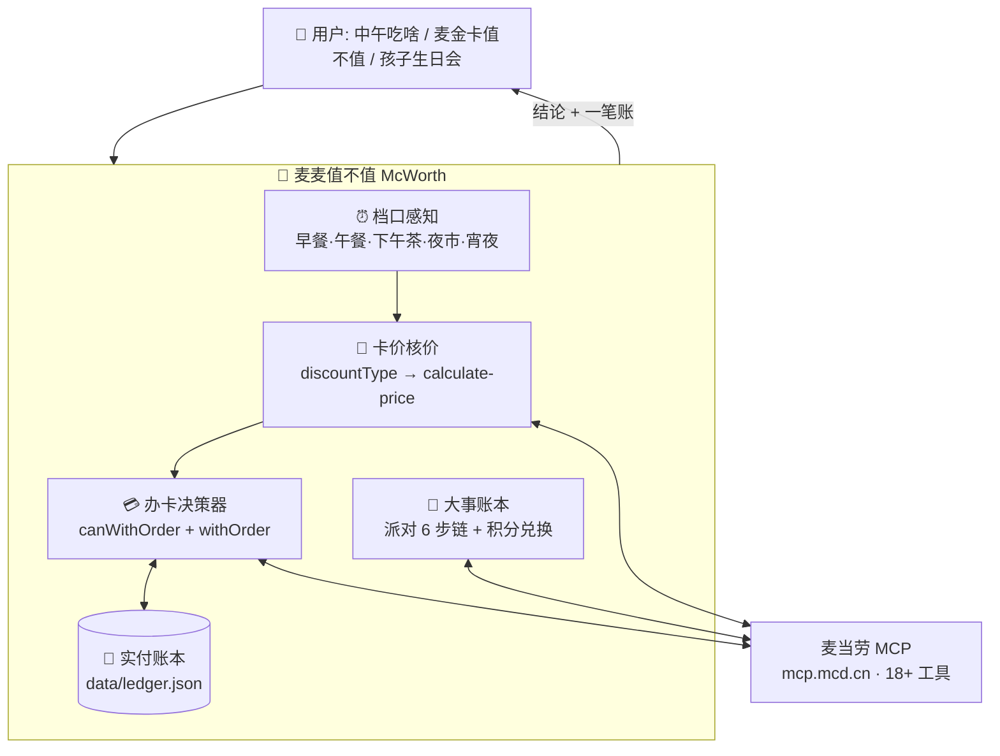

# 🧮 麦麦值不值 McWorth

**只算值不值的麦当劳权益精算 Skill**——不推荐你吃什么，只告诉你：这顿值不值，这张卡值不值，这件大事值不值。


## 为什么是它

你买了早餐卡，App 只会在菜单上标"早餐卡专享价"，但永远不会告诉你：**今天这顿省了多少、这个月回本了没有、档口还有几分钟截止**。你犹豫要不要开麦金卡，App 只会说"开通享 XX 项权益"，但不会告诉你：**你常点的那个套餐，持卡能省多少、一张 ¥9.9 的体验卡这一单就能赚回来**。

麦麦值不值补的就是这块空白。所有数字不是估算，全部来自麦当劳 MCP 接口的实时核价：

| 实测（2026-10-11，上海） | 原价 | 实付 | 省 |
|---|---|---|---|
| 吉士蛋麦满分组合（早餐卡价） | ¥12.0 | **¥7.2** | ¥4.8 |
| 麦咖啡™冰美式（卡价跨档仍生效） | ¥19.0 | **¥9.9** | ¥9.1 |
| 巨无霸四件套 + 麦金卡体验卡（15天） | ¥68.4 | **¥41.9** | **¥26.5** |

最后一行是关键：花 ¥9.9 随单购一张麦金卡体验卡，**这一单立刻省回 ¥26.5，净赚 ¥16.6**。这不是营销话术，是核价接口盖章的数字。

## 三层能力

**① 这顿值不值 —— 每天用**
> "中午吃啥" → 档口感知（还剩几分钟）→ 只挑有优惠的商品 → 接口核价 → 一个结论带一笔账。
> 早餐档 10:15 硬截止，剩 30 分钟先提醒你，再谈推荐。

**② 这张卡值不值 —— 杀手锏**
> "麦金卡值不值？" → 扫描可随单购商品 → 核出"持卡价" → 结合你的历史订单频次 → "花 ¥9.9，这一单净省 ¥16.6，值。"

**③ 这件大事值不值 —— 低频高值**
> "孩子生日会" → 19 个在售派对主题（疯狂动物城 / 唐老鸭 / 米妮 / 海底小纵队……¥45–198/人）→ 城市 → 门店 → 日期 → 场次（含余位与成团人数）→ 一笔总账 → 确认后下单。

## 架构



**一次对话，三个时间维度**：档口管"现在"，账本管"过去"，决策器管"未来"。完整工具编排见 [MCP_INTEGRATION.md](MCP_INTEGRATION.md)。

## 快速开始

**前置条件**：麦当劳中国大陆会员（在 [open.mcd.cn/mcp](https://open.mcd.cn/mcp) 申请 MCP Token）+ 任意支持 MCP 的客户端（WorkBuddy / Cherry Studio / Cursor 等）

1. 配置 MCP（Token 从环境变量注入，勿硬编码）：
```json
{
  "mcpServers": {
    "mcd-mcp": {
      "type": "streamablehttp",
      "url": "https://mcp.mcd.cn",
      "headers": { "Authorization": "Bearer ${MCD_MCP_TOKEN}" }
    }
  }
}
```
2. 把本仓库放入你的 AI 客户端工作目录，加载 [SKILL.md](SKILL.md)
3. 第一句话随便挑一句："中午吃啥" / "麦金卡值不值" / "孩子生日会怎么办"

## 目标用户

- 买了早餐卡 / 麦金卡但总用不满的人（沉没成本焦虑患者）
- 每次点单都在纠结"用哪张券最划算"的人
- 想办麦当劳生日会、但根本不知道能办的家长

## 隐私与安全

- 账本与卡有效期只存本地（`data/`），不上传、不外发
- 下单、领券、随单购等写操作前必须逐项确认，绝不静默执行
- 不读取、不推断、不存储你的会员卡官方状态——一切结论按"当前账号实付价"计算
- Token 走环境变量，仓库内只有占位符示例

## 技术栈

- 麦当劳官方 MCP Server（`https://mcp.mcd.cn`），18+ 工具编排，详见 [MCP_INTEGRATION.md](MCP_INTEGRATION.md)
- WorkBuddy（开发与运行环境）

## 参赛信息

- 赛事：麦当劳程序员创意开发大赛
- 赛期：2026-10-09 ~ 2026-10-25
- 本项目为参赛者独立开发的参赛作品，非麦当劳官方产品

## License

[MIT](LICENSE)
